

   2.0.0

# FragHub  (2.0.0)

## INSTALL INSTRUCTIONS BELOW
[See install instructions](#installation)

## DESCRIPTION
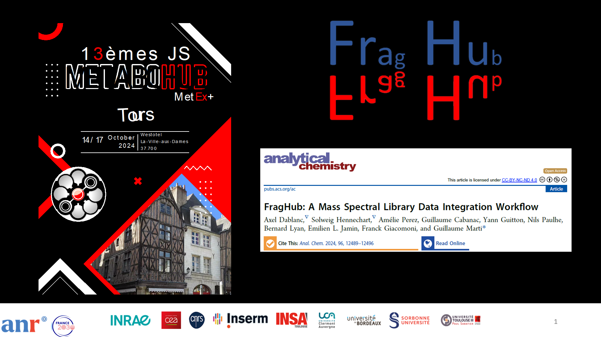
FragHub is a powerful tool designed to standardize and organize mass spectrometry (MS) data from OMSLs (Open Mass Spectra Libraries). The main objective of FragHub is to simplify and improve the process of MS data analysis by providing standardized, consistent, and easily accessible data. 
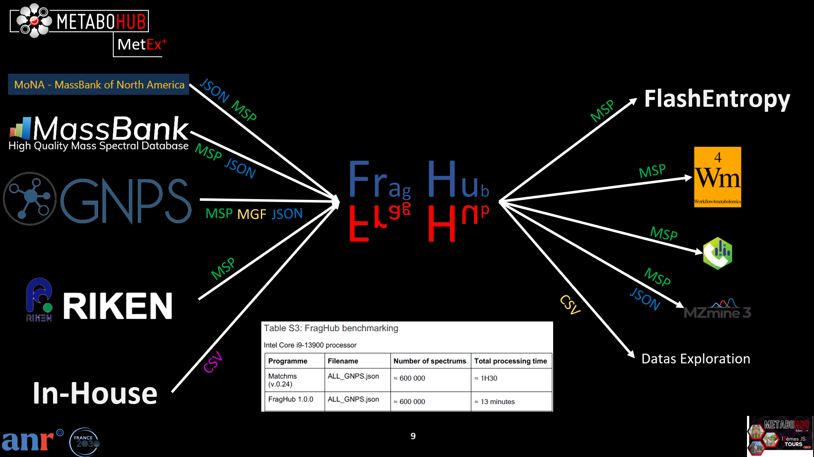
Key features: 
- **High-throughput processing**: Powered by a Rust-based core engine (via PyO3), FragHub 2.0 efficiently processes large-scale mass spectrometry libraries with significantly reduced computation times.
- **Data standardization**: FragHub standardizes field names and values of MS spectra from various databases, ensuring data consistency and compatibility.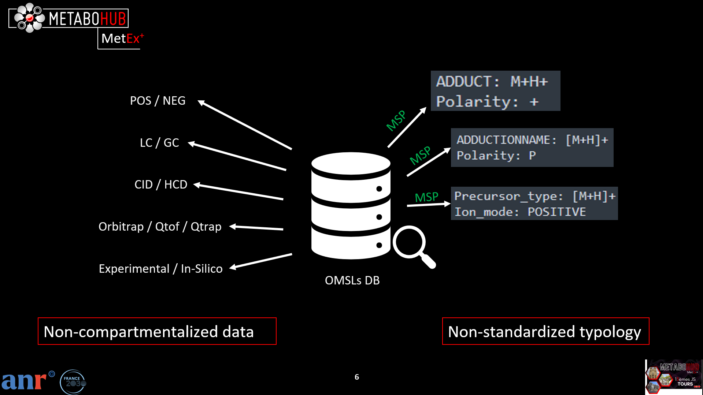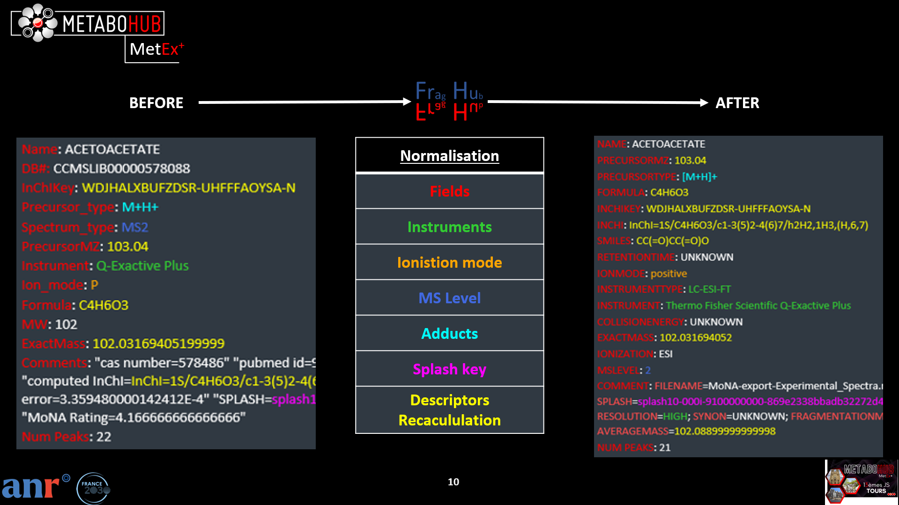
- **Optional peak list filtering**: FragHub applies filters to peak lists to streamline them by retaining only essential data, significantly reducing data size without compromising relevance for analysis.
- **Recalculation and normalization of chemical identifiers**: The program recalculates and normalizes chemical identifiers such as SMILES, InChI, and InChIKey, ensuring a uniform representation of molecular structures.
  - Salts are removed (desalting): for a structure with several components (e.g. "quinine sulfate"), the component matching the precursor m/z is kept, since only that molecule is measured.
  - Charges are neutralized when possible.
  - **InChI and InChIKey** are the standard IUPAC identifiers of this desalted, neutralized molecule, so they can be compared with PubChem and other databases.
  - **Output SMILES are normalized with RDKit**: they are written in the RDKit canonical tautomer form (stereochemistry kept), so that the same molecule is always written the same way. When the canonical tautomer would describe a different molecule (different InChI, e.g. keto/enol), the SMILES of the molecule as given is written instead. Output SMILES may therefore differ from the SMILES of the input files.
- **Ontologies**: FragHub completes the name and the chemical classes (ClassyFire and NPClassifier) of each molecule from its internal database, by InChIKey.
  - The internal molecule database used for this (names, ClassyFire and NPClassifier classes of 7.9 million molecules) is archived on Zenodo: [10.5281/zenodo.24203577](https://doi.org/10.5281/zenodo.24203577). It is bundled in the installers. It is not in the git repository: when FragHub runs from source, it downloads the database (1.1 GB) from Zenodo the first time it starts, or when `python build_backend.py` is run. See [Internal database](#internal-database) for its content.
- **Spectra organization**: FragHub separates spectra based on different experimental parameters such as polarity (positive/negative), chromatographic mode (LC/GC, or DI for direct injection without chromatography), and acquisition type (experimental/in silico), facilitating their use and subsequent analysis.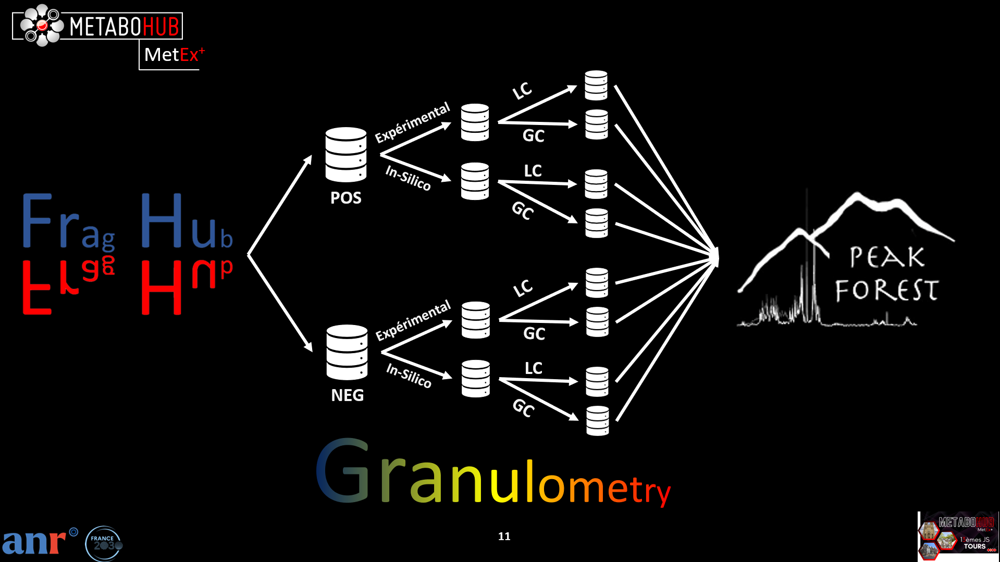
- **Compatibility with various analysis software**: Standardized spectra produced by FragHub are compatible with multiple analysis software, including MSdial, MZmine, and Flash Entropy Search, providing users with maximum flexibility in choosing analysis tools.

**Warning**: spectra that cannot be used are removed during the processing: no structure (no SMILES, InChI or InChIKey), no valid precursor m/z (when it cannot be recalculated from the adduct and the structure), no valid adduct or ionization mode, no peaks, "suspect" spectra annotated with the structure of a related compound, and duplicates. Each removed spectrum is written, with the reason, in the DELETED_SPECTRUMS folder of the output directory.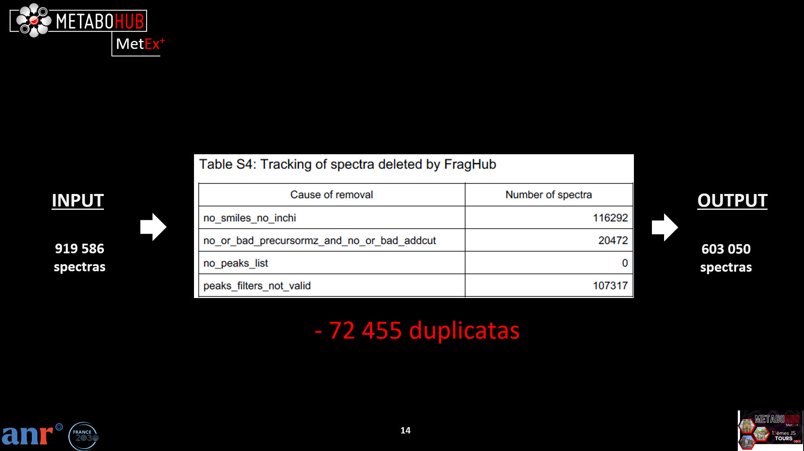

## INTERNAL DATABASE

FragHub completes every spectrum from an internal database of molecules, indexed by InChIKey: reference name, structure (InChI, SMILES), formula, exact and average masses, and chemical classes from two ontologies, [ClassyFire](https://doi.org/10.1186/s13321-016-0174-y) and [NPClassifier](https://doi.org/10.1021/acs.jnatprod.1c00399).

- **Version 2026-11-13**, archived on Zenodo: [10.5281/zenodo.24203577](https://doi.org/10.5281/zenodo.24203577) (17 Parquet files, 1.1 GB).
- Bundled in the installers; downloaded automatically from Zenodo when FragHub runs from source (`datas/internal_database.json` gives the version to use).

| | Molecules | Share |
|---|---:|---:|
| Molecules (InChIKey) | 7 948 489 | 100 % |
| With a structure (InChI, SMILES) | 7 472 387 | 94.0 % |
| With a name | 7 749 702 | 97.5 % |
| ClassyFire superclass / class / subclass | 948 654 / 943 680 / 821 642 | 11.9 % / 11.9 % / 10.3 % |
| NPClassifier pathway / superclass / class | 6 523 593 / 3 732 948 / 3 213 028 | 82.1 % / 47.0 % / 40.4 % |

ClassyFire: 25 superclasses, 480 classes, 791 subclasses. NPClassifier: 54 pathways, 1 136 superclasses, 4 536 classes (multiple classifications such as « Alkaloids | Terpenoids » counted as written in the database).

<table>
  <tr>
    <th>ClassyFire, with unknown</th>
    <th>ClassyFire, without unknown</th>
  </tr>
  <tr>
    <td>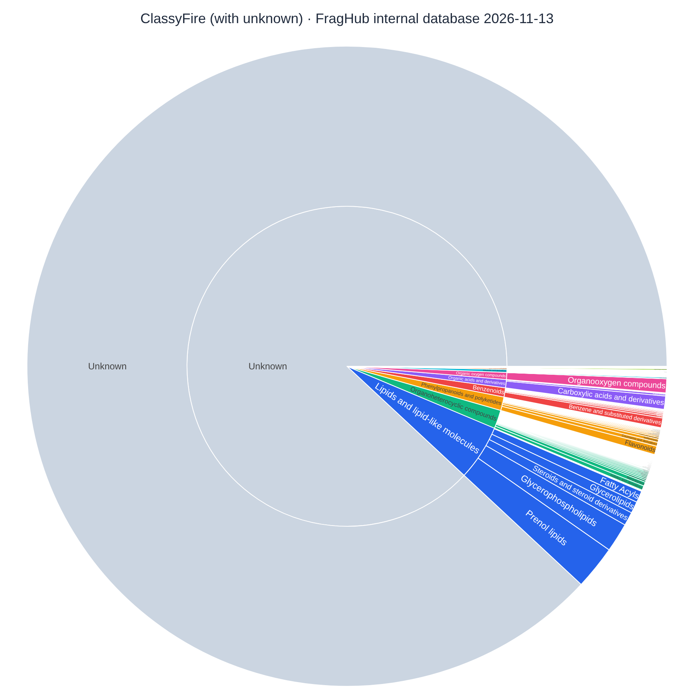</td>
    <td>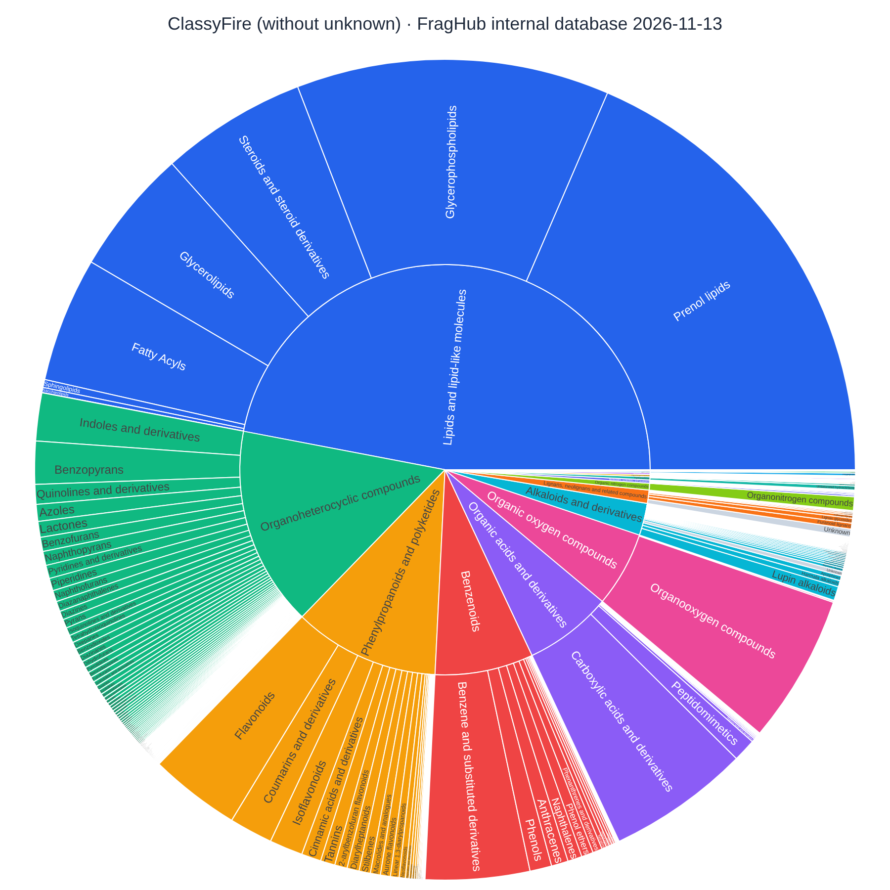</td>
  </tr>
  <tr>
    <th>NPClassifier, with unknown</th>
    <th>NPClassifier, without unknown</th>
  </tr>
  <tr>
    <td>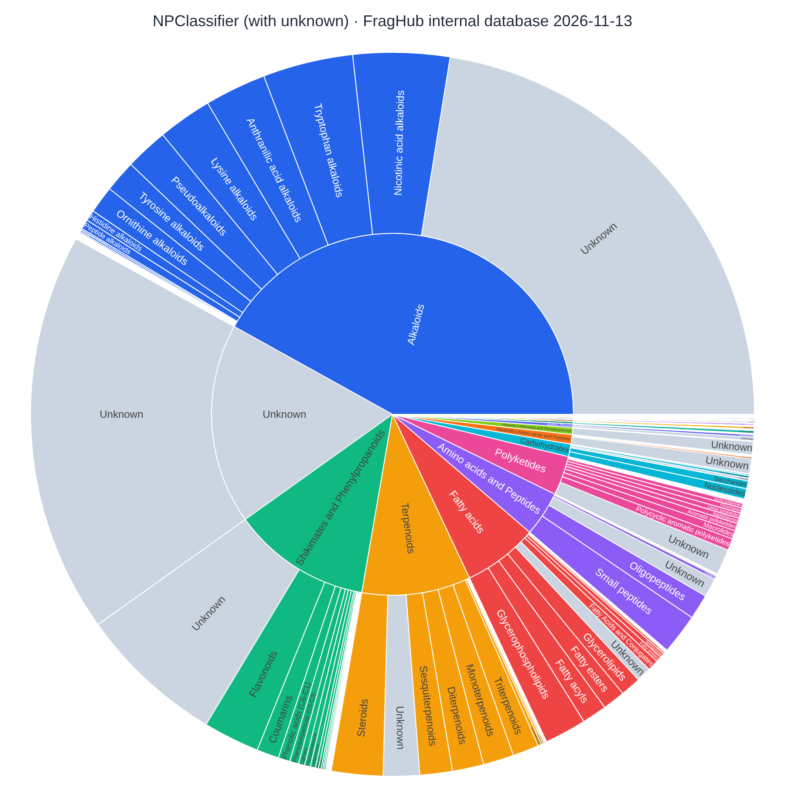</td>
    <td>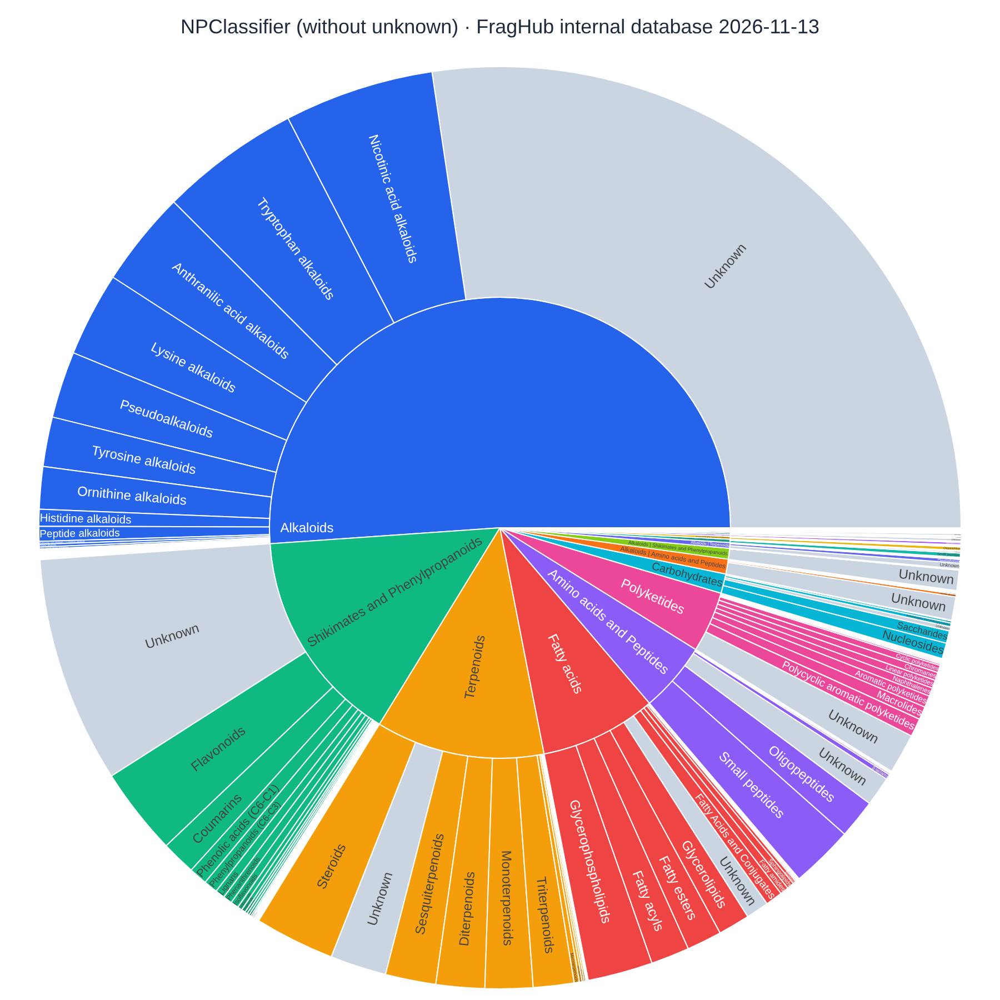</td>
  </tr>
</table>

Inner ring: superclass (ClassyFire) or pathway (NPClassifier); outer ring: class (ClassyFire) or superclass (NPClassifier). « Unknown » (grey): no class in the database. Without unknown, only the molecules with no class at any level are left out; the others keep their « Unknown » sectors at the lower levels.

> 🔎 **These pictures are static captures.** The interactive version (click a class to zoom in, switch between ClassyFire and NPClassifier, with or without unknown classes, hover to read the counts) is the file [documentation/internal_database/internal_database_metrics.html](documentation/internal_database/internal_database_metrics.html): download it (*Download raw file* on GitHub) and open it in a web browser. An internet connection is needed to load the Plotly library.

These figures are computed from the database by `python scripts/build_dataset/database_metrics.py` (to run again for each new version of the database).

## CONTACT

* **Developer :** <axel.dablanc@utoulouse.fr>
* **Project Manager :** <guillaume.marti@utoulouse.fr>

## INSTALLATION
1) Download FragHub executable corresponding to your OS HERE: 
   ~~**Windows** x64: [Download Windows x64 Installer](https://zenodo.org/records/17235741/files/FragHub_2.0.0_setup_windows_x64.exe?download=1) 
   **Linux** x64: [Download Linux x64 Installer](https://zenodo.org/records/17235741/files/FragHub_2.0.0_setup_Linux_x64?download=1) 
   **macOS** arm64: [Download macOS arm64 app](https://zenodo.org/records/17235741/files/FragHub_macOS_2.0.0_arm64.dmg?download=1) ~~
2) Execute setup installer (macOS: drag to App)
3) select installation folder
4) click install

## USE

To use this programme:

1) Go to install directory then run FragHub executable (feel free to create shortcut).
>NB: If you have a file that contains **only** In-Silico spectra AND this is not specified within the filename or the spectrum, you can simply suffix the filename with "_insilico", like this: "UNPD_ISDB_R_p01_insilico.mgf". 
 
>NB: If you have a file that contains **only** GC spectra AND this is not specified within the filename or the spectrum, you can simply suffix the filename with "_GC", like this: "GMD_20111121_MDN35_ALK_MSP_GC.msp". 

2) FragHub GUI start: **at any time you can move the mouse over 🛈 to view a detailed description** 
   1) First tab: Select single or multiple .json, .jsonl, .csv, .msp, or .mgf files. 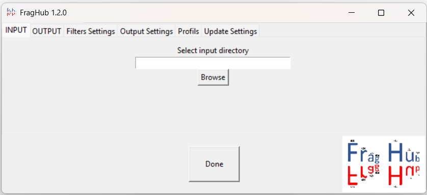
   2) Second tab: Create a new empty directory or Select an existing directory where FragHub has already written files 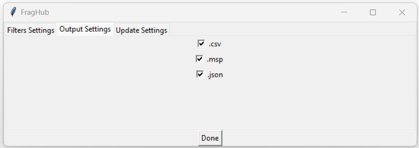
   3) Third tab: This area allows users to select specific filters for inclusion during the processing stage. Moreover, it provides the option to adjust the respective parameters of each filters. 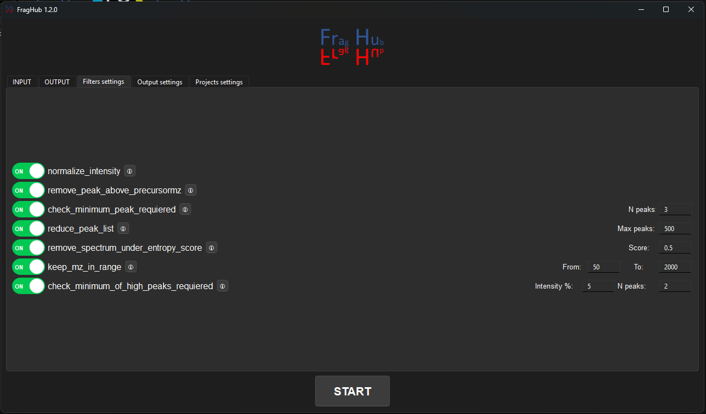
   4) Fourth tab: This area allows the user to choose whether or not to perform the calculation of de novo fragment formulas. 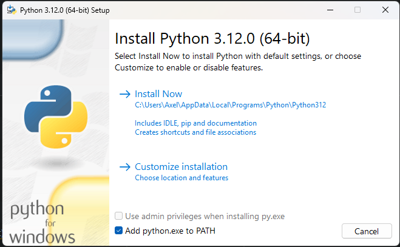
   5) Fifth tab: Select the output file formats of your preference (CSV, MSP, JSON, mzSpecLib JSON). By default, all formats are selected. 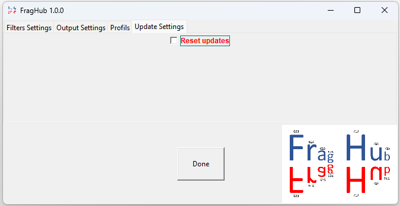
   6) Sixth tab: FragHub saves the SPLASH keys of previous spectra processed. So that at the next update, only new spectra from the database are processed, and added to previous FragHub processes. Resetting the project allows you to delete splash keys and output files from the selected project, in order to start a new project from scratch. The "Write perf logs" switch (off by default) writes a performance log of the run (duration, memory and CPU usage of each step) in the PERF_LOGS sub-folder of the output directory. 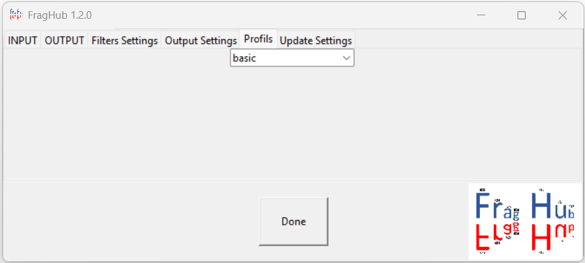
   7) Click on START button to run the programme.
3) Progress starts. At any time you can click on the STOP PROCESS button to stop the processing. 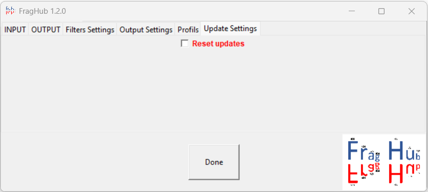
4) When progress is finished, the HTML RESULT tab shows the report of the run. Click on the CLOSE REPORT button to go back to the settings. 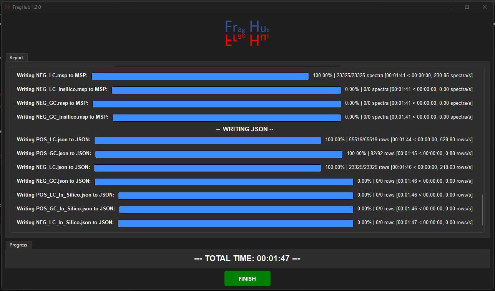
5) **DO NOT DELETE FILES INTO YOUR SELECTED OUTPUT DIRECTORY AFTER COPY CLEANED VERSIONS.**
---

## TECHNICAL DOCUMENTATION

Please refer to the [technical documentation](documentation/) for comprehensive details regarding the architecture, inner workings, and development of FragHub. To run FragHub from source or build the installers, see the [developer documentation](documentation/Documentation.md).

---

## TESTS

FragHub is checked by automatic tests: unit tests of the Rust engine, tests of the whole engine on hand-written spectra, an end-to-end run compared with a reference output, and tests of the graphical interface. See [TESTS.md](TESTS.md) to run them and read their results.

---

## HEADLESS CLI MODE

FragHub 2.0 introduces a headless Command Line Interface (CLI). This feature enables seamless integration into automated data pipelines and server environments, utilizing the Rust core engine without requiring a graphical user interface.

Please refer to the [CLI Documentation](documentation/Documentation_CLI.md) for comprehensive usage instructions, available arguments, and pipeline integration examples.

---

## FILTERS

The filters are chosen in the Filters tab; all of them are on by default. Peaks with an m/z or an intensity that is zero, negative or not a number are always removed. The other filters are applied in this order:

**remove_peak_above_precursormz** 
Removes the peaks whose m/z is above the precursor m/z + 5 Da. For a multiply charged precursor (e.g. [M+2H]2+), the limit is charge × precursor m/z + 5 Da, since a singly charged fragment can be heavier than its precursor's m/z. 

**keep_mz_in_range** (default: from 50 to 2000) 
Removes the peaks whose m/z is not between `From` and `To` (both included). 

**reduce_peak_list** (default: 500 peaks) 
Keeps only the most intense peaks, up to the maximum number of peaks. 

**check_minimum_peak_requiered** (default: 3 peaks) 
Deletes the spectrum if it has fewer peaks than the minimum, counted after the filters above. 

**normalize_intensity** 
Divides the intensities by the highest one, so that the most intense peak is 1 (relative intensities rounded to 8 decimals). 

**check_minimum_of_high_peaks_requiered** (default: 2 peaks at 5 %) 
Deletes the spectrum if fewer than N peaks reach the given percentage of the highest intensity. 

**remove_spectrum_under_entropy_score** (default: 0.5) 
Deletes the spectrum if its normalized spectral entropy (between 0 and 1, [Li et al. 2021](https://doi.org/10.1038/s41592-021-01331-z)), computed on the filtered peaks, is below the score. The entropy of every spectrum is written in the ENTROPY field. 

When a filter removes all the peaks of a spectrum, the spectrum is deleted. Deleted spectra are listed in the DELETED_SPECTRUMS folder, one file per reason.

## REQUIRED CSV FILE
1) CSV files need to be separated by '**;**' or '**\t**', with quote character '**"**'. 
2) The peaks column needs to be named '**peaks**' (or '**peaks_list**', in any case). 
3) The '**peaks**' column needs to be formatted with one of the following formats, as a string:
   1) >"[[79.054840, 12486.074219], [79.629868, 854.089905]]"
   2) > " 
   57.07042529 0.7697591662 
   71.08607535 1.507457981 
   97.06533991 0.4893302623 
   99.08098997 0.4737337839 
   137.09664 0.498920401 
   165.0915547 0.4243093978 
   " 
   3) > "314.00000000 1.00000000;315.00000000 0.15715716;316.00000000 0.35735736;317.00000000 0.05105105"
    
