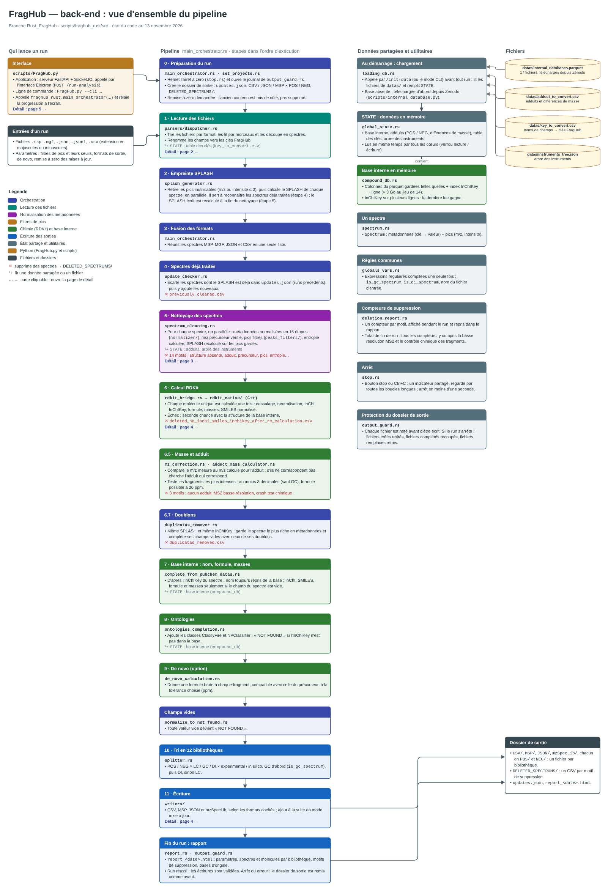
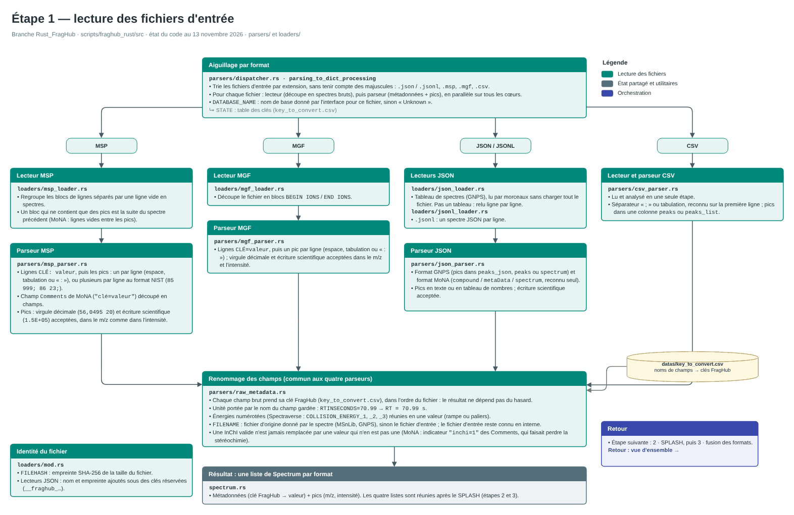
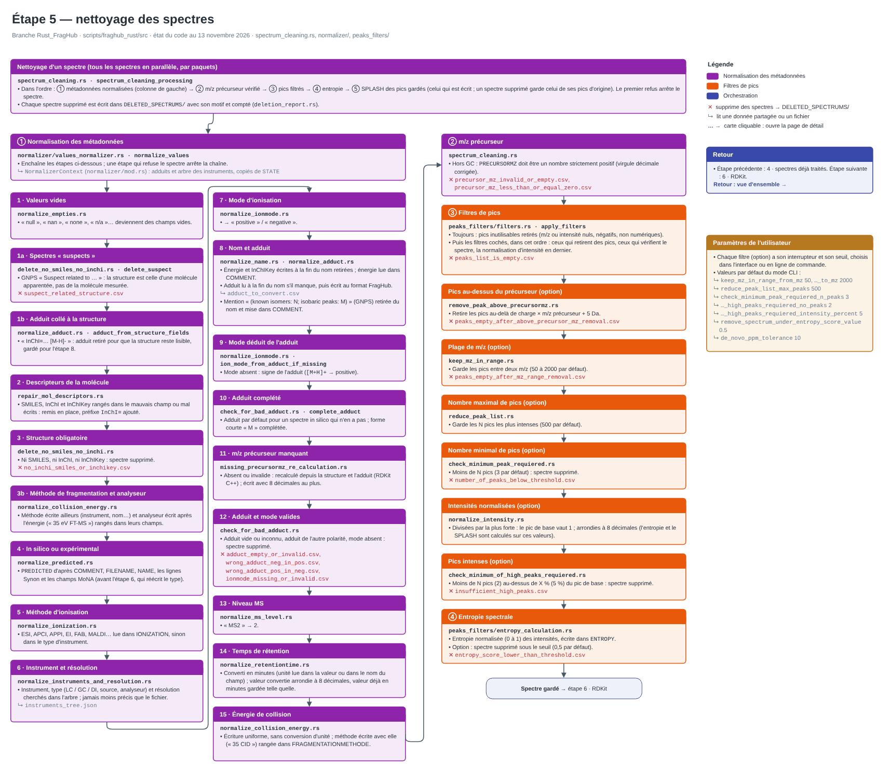
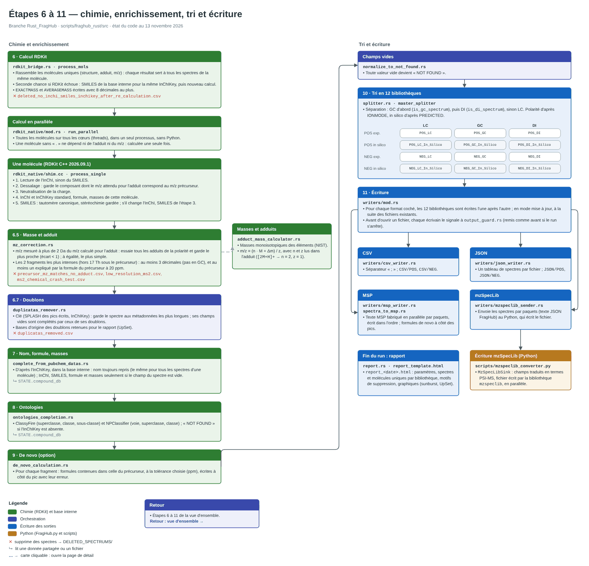
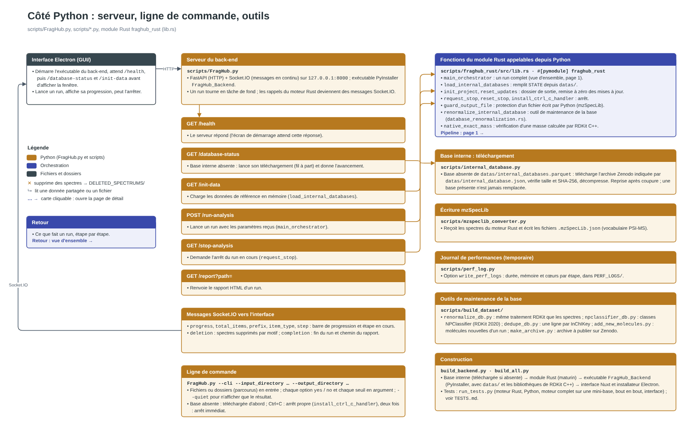
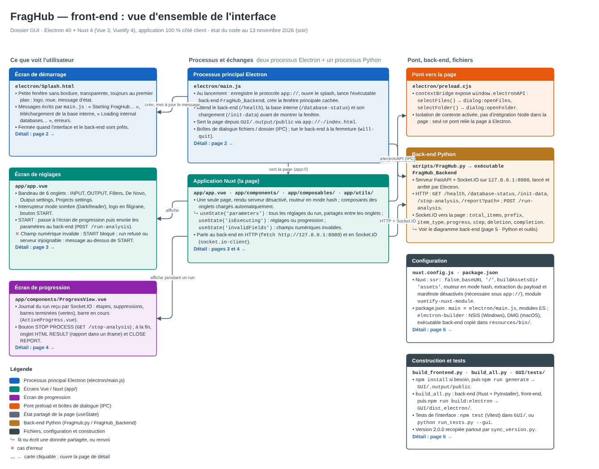
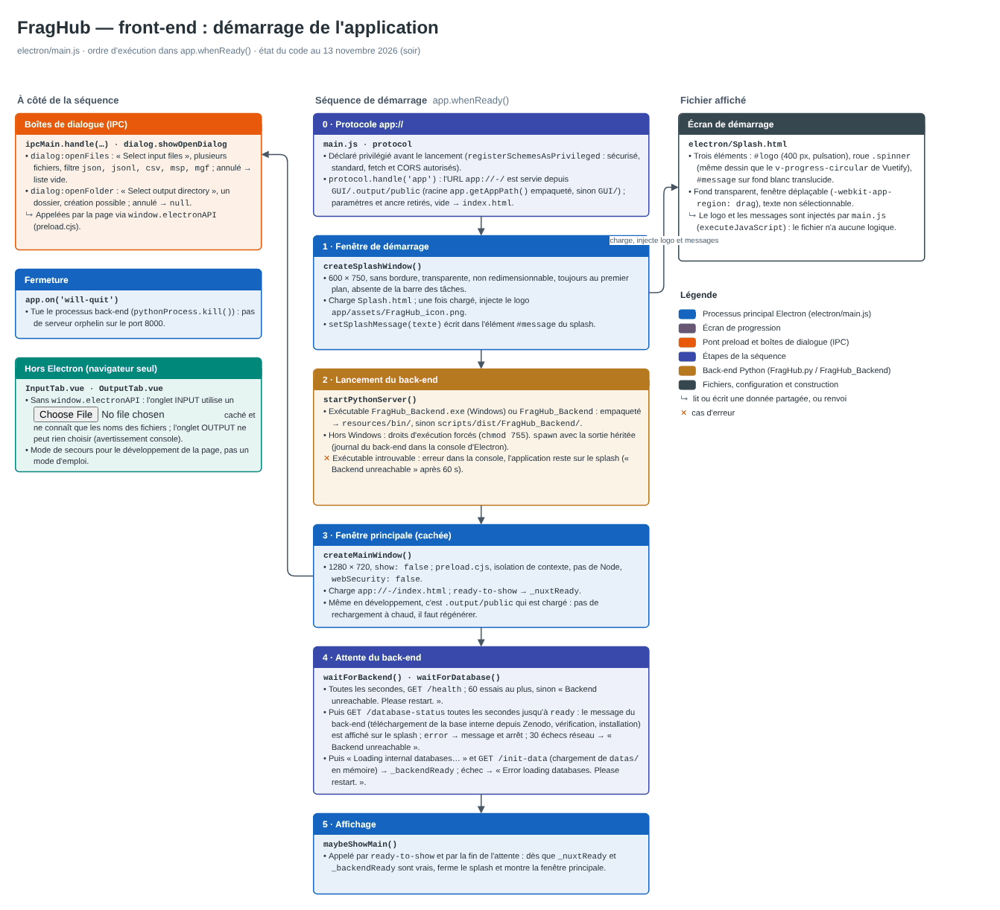
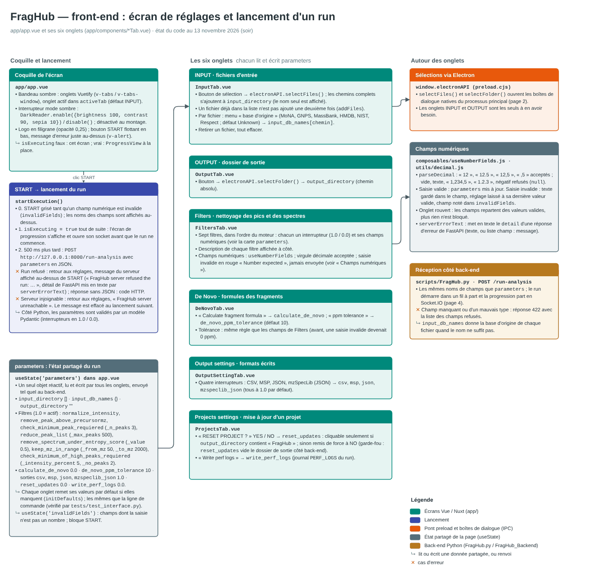
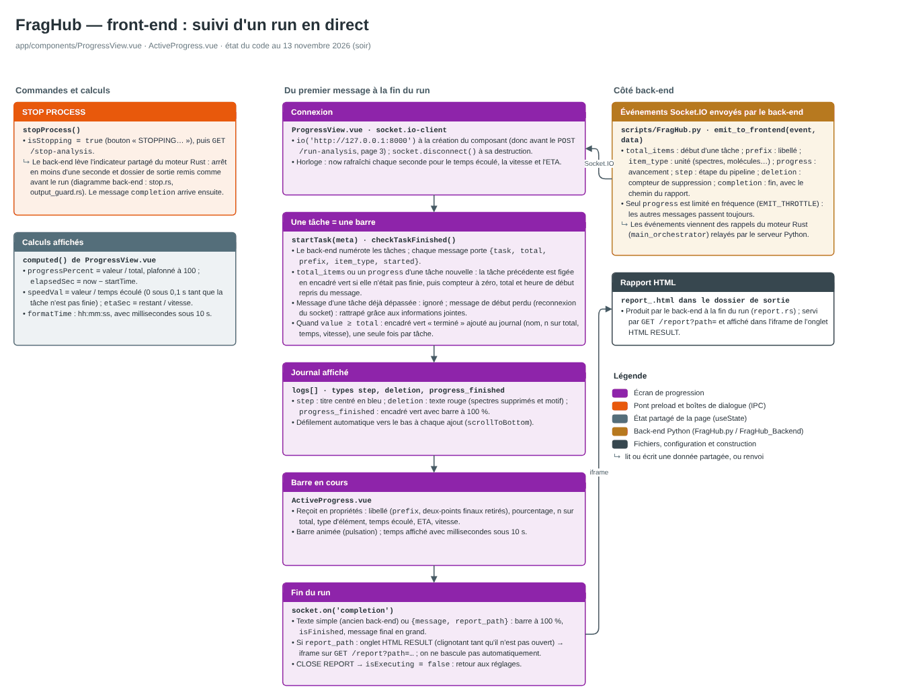
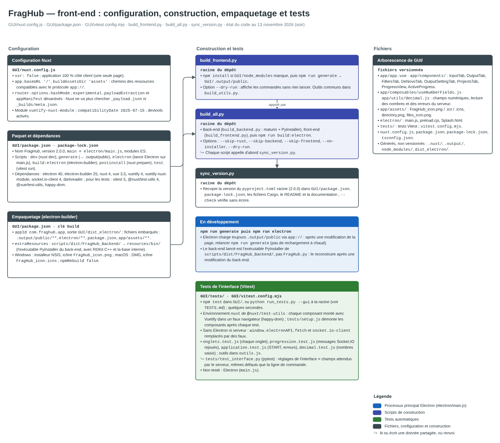

# FragHub technical documentation

This folder describes how FragHub is built and how it works inside. To use FragHub, the [main README](../README.md) is enough.

| File | Content |
|---|---|
| [Documentation.md](Documentation.md) | Developer documentation: environment, running FragHub from source, building the installers, version number, RDKit C++ engine |
| [Documentation_CLI.md](Documentation_CLI.md) | Command line mode (no graphical interface): arguments and pipeline examples |
| [Documentation_Linux.md](Documentation_Linux.md), [Documentation_macOS.md](Documentation_macOS.md) | Building and running FragHub on Linux and macOS |
| [Backend_component_diagram.drawio](Backend_component_diagram.drawio) | Diagram of the processing engine (Rust), 5 pages |
| [Frontend_component_diagram.drawio](Frontend_component_diagram.drawio) | Diagram of the graphical interface (Electron + Nuxt), 5 pages |
| [internal_database/](internal_database/) | Metrics and sunbursts of the internal molecule database (see the main README) |
| [../TESTS.md](../TESTS.md) | Automatic tests: how to run them and read their results |

## Component diagrams

The two `.drawio` files are diagrams made with [draw.io](https://www.drawio.com/) (also called diagrams.net). Each one has several pages: an overview, then one page per part, with the source files, what each step does and why a spectrum can be deleted. To open them with their clickable links between pages, use [app.diagrams.net](https://app.diagrams.net/) (*File > Open from > Device*), the draw.io desktop application, or the draw.io extension of VS Code or JetBrains IDEs.

The pictures below are snapshots of each page, so you can see what is inside without draw.io. The diagrams are written in French. Click a picture to open it at full size.

### Back-end: the processing engine (Rust)

| | |
|---|---|
| **1 · Overview**: the pipeline from the input files to the output folder, step by step, with the shared data and files.   | **2 · Reading the files**: how MSP, MGF, JSON, JSONL and CSV files are read, split into spectra and their fields renamed.   |
| **3 · Spectrum cleaning**: the normalization of the metadata, the precursor m/z check, the peak filters and the entropy.   | **4 · Chemistry and outputs**: structure calculation with RDKit, mass and adduct check, duplicates, name, formula and classes from the internal database, de novo formulas, sorting into 12 libraries and writing of the output files.   |
| **5 · Python and tools**: the Python server (its HTTP routes), the command line and the tools around the engine.   | |

### Front-end: the graphical interface (Electron + Nuxt)

| | |
|---|---|
| **1 · Overview**: Electron, the Nuxt pages and the Python back-end, and how they talk to each other.   | **2 · Startup (Electron)**: splash screen, launch of the back-end, main window, file dialogs and closing.   |
| **3 · Settings screen**: the six tabs, the shared parameters and the START button.   | **4 · Progress screen**: the live progress sent by the back-end (Socket.IO), the STOP PROCESS button and the HTML report.   |
| **5 · Build, files and tests**: configuration, packaging of the installers, build scripts, interface tests (Vitest) and the files of the GUI folder.   | |

The snapshots show the diagrams as of November 13, 2026. When a diagram changes, export its pages again from draw.io (*File > Export as > PNG*) under the same names.
